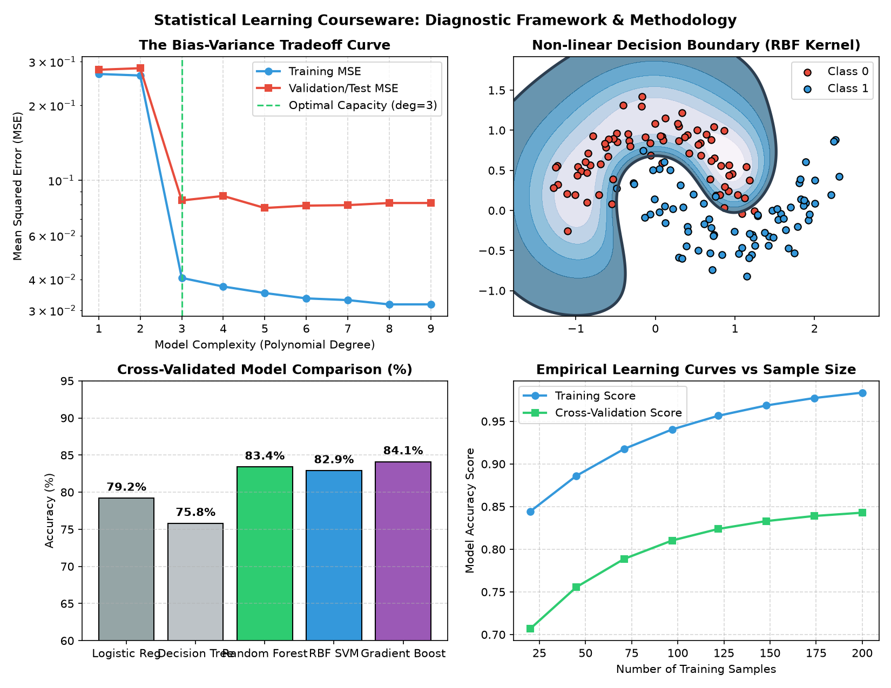

# Statistical Learning & Machine Learning: Comprehensive TA Courseware

[](https://www.python.org/)
[](https://scikit-learn.org/)
[](https://jupyter.org/)
[](LICENSE)

Official Teaching Assistant (TA) instructional laboratory curriculum, practical coding tutorials, and applied machine learning case studies developed by **Javad Sajadi**.

---

## 📊 Course Methodology & Empirical Visualizations

Below is the multi-panel visual showcase illustrating core statistical learning concepts covered across the curriculum:



*Curriculum diagnostic panels demonstrating the theoretical and empirical Bias-Variance Tradeoff, non-linear Kernel SVM decision boundaries, cross-validated multi-model accuracy benchmarks, and empirical sample size learning curves.*

---

## 📚 Curriculum & Notebook Syllabus

The courseware progresses systematically from computational foundations to rigorous predictive modeling and validation:

### Part I: Scientific Computing Foundations (`TA0`)
- **[`TA0_Python.ipynb`](TA0_Python.ipynb):** Python idioms, functional constructs (list comprehensions, lambdas, iterators), and control flow.
- **[`TA0_Numpy.ipynb`](TA0_Numpy.ipynb):** High-performance vectorization, matrix algebra, array broadcasting, and slicing mechanics.
- **[`TA0_Pandas.ipynb`](TA0_Pandas.ipynb):** Tabular data manipulation, multi-indexing, aggregation, missing value imputation, and merging.
- **[`TA0_Matplotlib.ipynb`](TA0_Matplotlib.ipynb):** Publication-quality scientific figures, subplots, distribution plotting, and aesthetic styling.

### Part II: Code Optimization & Engineering (`TA1`)
- **[`TA1_betterCodding.ipynb`](TA1_betterCodding.ipynb):** Efficient memory patterns, avoiding slow Python loops via vectorization, profiling, and algorithmic refactoring.

### Part III: Statistical Learning & Model Evaluation (`TA2`)
- **[`TA2_modelselection.ipynb`](TA2_modelselection.ipynb):** The Bias-Variance Tradeoff, $K$-Fold Cross-Validation, regularized regression (Lasso/Ridge), hyperparameter grid search, and learning curves.

### Part IV: Applied Real-World Machine Learning Case Studies (`TA3` & `TA4`)
- **[`TA3_Titanic.ipynb`](TA3_Titanic.ipynb):** Binary classification case study covering feature engineering, demographic title extraction, and ensemble classifier benchmarking.
- **[`TA4_WineQuality.ipynb`](TA4_WineQuality.ipynb):** Multi-attribute regression and classification on physicochemical wine sensor properties.

---

## 🚀 Getting Started

### 1. Installation
Clone the repository and install the standard scientific computing stack:
```bash
git clone https://github.com/javad-sajadi/StatisicalLearningTa.git
cd StatisicalLearningTa
pip install -r requirements.txt
```

### 2. Launching Tutorials
Launch the interactive Jupyter environment:
```bash
jupyter notebook
```

---

## 📁 Repository Structure

```
.
├── TA0_Python.ipynb                # Module 0A: Modern Python Programming Foundations
├── TA0_Numpy.ipynb                 # Module 0B: Vectorized Linear Algebra & Array Computing
├── TA0_Pandas.ipynb                # Module 0C: Exploratory Data Wrangling & Manipulation
├── TA0_Matplotlib.ipynb            # Module 0D: Data Visualization & Scientific Plotting
├── TA1_betterCodding.ipynb         # Module 1: Code Optimization & High-Performance Python
├── TA2_modelselection.ipynb        # Module 2: Model Selection, Cross-Validation & Regularization
├── TA3_Titanic.ipynb               # Module 3: End-to-End Classification Benchmark
├── TA4_WineQuality.ipynb           # Module 4: Physicochemical Regression Case Study
├── statistical_learning_showcase.png # Multi-panel theoretical & empirical concept preview
├── requirements.txt                # Python dependency specifications
└── .gitignore                      # Clean Git ignore rules for checkpoints and cache
```

---

## 📜 Author & License
- **Instructor / TA:** [Javad Sajadi](https://github.com/javad-sajadi)
- **Course:** Statistical Learning & Machine Learning
- **License:** MIT License
